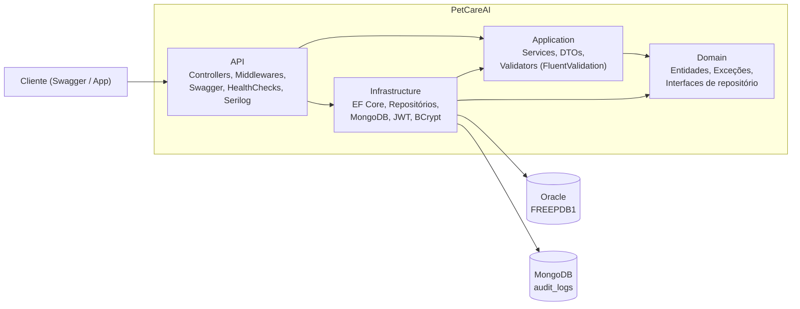
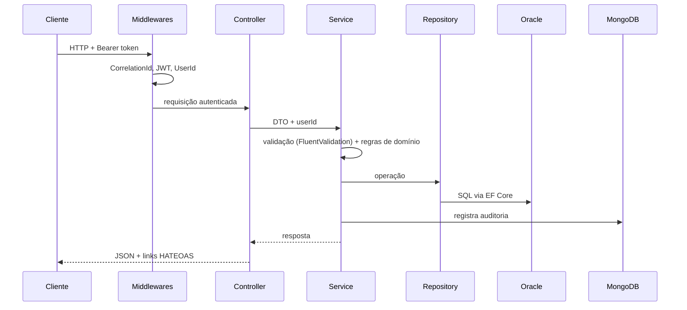

# 🐾 PetCareAI+ — API para acompanhamento da vida do pet

API RESTful em **.NET 10** para tutores acompanharem a vida dos seus pets: cadastro de pets, agendamento de consultas e controle da carteira de vacinas. Projeto da disciplina **Advanced Business Development with .NET** (FIAP) — 4ª Sprint.

🔗 **Repositório:** <https://github.com/Guilhermedev2807/Sprint4.NET>

## Sumário

1. [Visão geral](#visão-geral)
2. [Arquitetura](#arquitetura)
3. [Tecnologias](#tecnologias)
4. [Endpoints](#endpoints)
5. [Como instalar e rodar](#como-instalar-e-rodar)
6. [Como testar](#como-testar)
7. [Monitoramento e observabilidade](#monitoramento-e-observabilidade)
8. [Estrutura de pastas](#estrutura-de-pastas)
9. [Integrantes](#integrantes)

---

## Visão geral

O PetCareAI+ permite que cada tutor:

- crie conta e faça login (JWT);
- cadastre, edite, liste e exclua seus pets;
- agende e acompanhe consultas veterinárias;
- controle vacinas e saiba quais estão pendentes (próxima dose em até 30 dias);
- tenha **isolamento de dados**: cada usuário só acessa os próprios registros (o `userId` vem da claim do token).

Persistência híbrida:

| Banco | Uso |
|---|---|
| **Oracle** (EF Core + migrations) | Dados relacionais: `USUARIO`, `PET`, `CONSULTA`, `VACINA` |
| **MongoDB** | Trilha de auditoria (`audit_logs`) das ações do usuário |

## Arquitetura

O projeto segue **Clean Architecture**, com dependências apontando para dentro (o Domain não depende de ninguém).



**Fluxo de uma requisição:**



**Princípios aplicados**

- **SOLID** e **Clean Code**: serviços com responsabilidade única, dependência de abstrações, entidades com regras de negócio encapsuladas (construtores validados, setters privados).
- **Injeção de dependência**: `AddApplication()` e `AddInfrastructure()`.
- **Padrão Repository**: interfaces no Domain, implementações concretas na Infrastructure.
- **Tratamento global de exceções**: `ExceptionHandlingMiddleware` converte exceções em `ProblemDetails`.

| Exceção | HTTP |
|---|---|
| `ValidationException` / `DomainException` | 400 |
| `UnauthorizedAppException` / token ausente | 401 |
| `NotFoundException` | 404 |
| `ConflictException` | 409 |
| Qualquer outra | 500 (sem expor detalhes) |

## Tecnologias

- .NET 10 / ASP.NET Core (Controllers)
- Entity Framework Core + Oracle (`Oracle.EntityFrameworkCore`)
- MongoDB (`MongoDB.Driver`)
- JWT Bearer + BCrypt
- FluentValidation
- OpenAPI nativo + Swagger UI (botão **Authorize**)
- Serilog (console + arquivo)
- Health Checks (Oracle e MongoDB)
- xUnit, Moq, FluentAssertions, `WebApplicationFactory`, Coverlet
- Docker Compose (Oracle Free 23ai e MongoDB 7)

## Endpoints

Todos os endpoints, exceto `/api/auth/*` e `/health*`, exigem `Authorization: Bearer <token>`.

### Autenticação

| Método | Rota | Descrição |
|---|---|---|
| POST | `/api/auth/register` | Cria conta e retorna o token |
| POST | `/api/auth/login` | Autentica e retorna o token |

### Pets

| Método | Rota | Descrição |
|---|---|---|
| GET | `/api/pets` | Lista paginada, ordenada e filtrada |
| GET | `/api/pets/{id}` | Detalhe do pet |
| POST | `/api/pets` | Cria pet |
| PUT | `/api/pets/{id}` | Atualiza pet |
| DELETE | `/api/pets/{id}` | Remove pet (e suas consultas/vacinas) |

### Consultas

| Método | Rota | Descrição |
|---|---|---|
| GET | `/api/consultas` | Lista paginada, com filtros |
| GET | `/api/consultas/{id}` | Detalhe |
| POST | `/api/consultas` | Agenda consulta |
| PUT | `/api/consultas/{id}` | Atualiza (inclui status) |
| DELETE | `/api/consultas/{id}` | Remove |

### Vacinas

| Método | Rota | Descrição |
|---|---|---|
| GET | `/api/vacinas` | Lista paginada, com filtros |
| GET | `/api/vacinas/{id}` | Detalhe (campo `pendente`) |
| POST | `/api/vacinas` | Registra vacina |
| PUT | `/api/vacinas/{id}` | Atualiza |
| DELETE | `/api/vacinas/{id}` | Remove |

### Paginação, ordenação e filtros

| Recurso | Query params |
|---|---|
| Pets | `page`, `pageSize` (máx. 100), `sort` (`nome`, `-nome`, `peso`, `-peso`), `especie` |
| Consultas | `page`, `pageSize`, `sort` (`data`, `-data`), `petId`, `status` (1 Agendada, 2 Realizada, 3 Cancelada) |
| Vacinas | `page`, `pageSize`, `sort` (`nome`, `-nome`, `proxima`), `petId` |

Exemplo: `GET /api/pets?page=1&pageSize=10&sort=-peso&especie=Cachorro`

### HATEOAS

Os endpoints de consulta (GET) retornam `data` e `links`:

```json
{
  "data": { "id": "2c094bb8-...", "nome": "Rex", "especie": "Cachorro", "idade": 4, "peso": 13.8 },
  "links": [
    { "href": "/api/pets/2c094bb8-...", "rel": "self", "method": "GET" },
    { "href": "/api/pets/2c094bb8-...", "rel": "update", "method": "PUT" },
    { "href": "/api/pets/2c094bb8-...", "rel": "delete", "method": "DELETE" },
    { "href": "/api/consultas?petId=2c094bb8-...", "rel": "consultas", "method": "GET" },
    { "href": "/api/vacinas?petId=2c094bb8-...", "rel": "vacinas", "method": "GET" }
  ]
}
```

### Documentação Swagger/OpenAPI

Com a API rodando:

- Swagger UI: <http://localhost:5238/swagger>
- Documento OpenAPI (JSON): <http://localhost:5238/openapi/v1.json>

Para autenticar: faça `POST /api/auth/login`, copie o `token`, clique em **Authorize** e cole o valor.

## Como instalar e rodar

### Pré-requisitos

- [.NET SDK 10](https://dotnet.microsoft.com/download)
- [Docker Desktop](https://www.docker.com/products/docker-desktop/) (aberto, com "Engine running")
- Git
- Ferramenta de migrations: `dotnet tool install --global dotnet-ef`

### Passo a passo

```bash
# 1. Clonar
git clone https://github.com/Guilhermedev2807/Sprint4.NET.git
cd Sprint4.NET

# 2. Subir Oracle e MongoDB
docker compose up -d
#    O Oracle leva 1 a 2 minutos na primeira vez.
#    Aguarde "DATABASE IS READY TO USE!" em:
docker logs petcare-oracle --tail 5

# 3. Aplicar as migrations (cria as tabelas no Oracle)
dotnet ef database update --project src/PetCareAI.Infrastructure --startup-project src/PetCareAI.API

# 4. Rodar a API
dotnet run --project src/PetCareAI.API
```

A API sobe em <http://localhost:5238>.

### Configuração

`src/PetCareAI.API/appsettings.json`:

```json
{
  "ConnectionStrings": {
    "Oracle": "User Id=petcare;Password=PetCare123;Data Source=localhost:1521/FREEPDB1",
    "Mongo": "mongodb://localhost:27017"
  },
  "Jwt": {
    "Key": "troque-esta-chave-por-uma-bem-grande-32chars!",
    "Issuer": "PetCareAI",
    "Audience": "PetCareAI",
    "ExpiresMinutes": 120
  }
}
```

> Os valores acima são apenas para ambiente local de desenvolvimento. Em produção, use variáveis de ambiente ou um cofre de segredos.

Credenciais do `docker-compose.yml`: Oracle `petcare` / `PetCare123` (serviço `FREEPDB1`, porta 1521) e MongoDB sem autenticação (porta 27017).

## Como testar

### Testes automatizados

```bash
dotnet test
```

São **27 testes** (padrão **AAA**, xUnit), que não dependem do Docker:

| Projeto | Tipo | O que cobre |
|---|---|---|
| `PetCareAI.Domain.Tests` | Unitários | Regras de `Pet`, `Usuario`, `Consulta` e `Vacina` |
| `PetCareAI.Application.Tests` | Unitários (Moq) | `AuthService` e `PetService`: sucesso, validação, não encontrado, conflito, não autorizado |
| `PetCareAI.Integration.Tests` | Integração (`WebApplicationFactory`, banco InMemory) | Registro, login, 401 sem token, 409 e-mail duplicado, 400 validação, CRUD de pet com token e isolamento por usuário |

Cobertura (Coverlet):

```bash
dotnet test --collect:"XPlat Code Coverage"
```

### Teste manual (Swagger)

1. `POST /api/auth/register`

```json
{ "nome": "Guilherme", "email": "guilherme@teste.com", "senha": "123456" }
```

2. **Authorize** com o token retornado.
3. `POST /api/pets`

```json
{ "nome": "Rex", "especie": "Cachorro", "raca": "Labrador", "dataNascimento": "2022-05-10T00:00:00Z", "peso": 12.5 }
```

4. `POST /api/consultas` (use o `id` do pet em `petId`)

```json
{ "petId": "ID_DO_PET", "dataHora": "2026-11-20T14:30:00Z", "veterinario": "Dra. Camila Souza", "motivo": "Check-up anual", "status": 1 }
```

5. `POST /api/vacinas`

```json
{ "petId": "ID_DO_PET", "nome": "Antirrábica", "dataAplicacao": "2025-11-15T00:00:00Z", "proximaDose": "2026-11-15T00:00:00Z" }
```

6. `GET /api/pets?page=1&pageSize=10&sort=nome`

Casos de erro verificáveis: peso `0` (400), e-mail repetido (409), senha errada (401), `petId` de outro usuário (404), requisição sem token (401).

## Monitoramento e observabilidade

### Health Checks

| Rota | Verifica |
|---|---|
| `/health` | API no ar |
| `/health/db` | Conexão com o Oracle |
| `/health/mongo` | Conexão com o MongoDB |

Respondem `Healthy` ou `Unhealthy` (teste: `docker stop petcare-mongo` e abra `/health/mongo`).

### Logging estruturado (Serilog)

- Saída no console e em arquivo rotativo diário: `logs/petcare-AAAAMMDD.log`.
- Cada requisição registra `CorrelationId` (header `X-Correlation-Id`, devolvido na resposta) e `UserId` (claim do JWT).
- Erros 500 são logados com stack trace; a resposta ao cliente não expõe detalhes internos.

### Auditoria (MongoDB)

Ações como `USUARIO_REGISTRADO`, `LOGIN`, `PET_CRIADO`, `PET_ATUALIZADO`, `CONSULTA_CRIADA` e `VACINA_REMOVIDA` ficam na coleção `audit_logs`:

```bash
docker exec petcare-mongo mongosh petcare --eval "db.audit_logs.find().pretty()"
```

## Estrutura de pastas

```
PetCareAI/
├── src/
│   ├── PetCareAI.Domain          # Entidades, exceções, interfaces de repositório
│   ├── PetCareAI.Application     # Services, DTOs, validators, contratos (ITokenService...)
│   ├── PetCareAI.Infrastructure  # EF Core/Oracle, MongoDB, repositórios, JWT, BCrypt, migrations
│   └── PetCareAI.API             # Controllers, middlewares, Swagger, HealthChecks, Serilog
├── tests/
│   ├── PetCareAI.Domain.Tests
│   ├── PetCareAI.Application.Tests
│   └── PetCareAI.Integration.Tests
├── docker-compose.yml
└── README.md
```

## Integrantes

| Nome | RM |
|---|---|
| Guilherme de Andrade Martini | RM566087 |
| Raphael Gomes Mancera | RM562279 |
| Bruno Vinicius Barbosa | RM566366 |
| Nathan Gonçalves Pereira Mendes | RM564666 |

---

Projeto acadêmico — FIAP, Advanced Business Development with .NET, 4ª Sprint.
